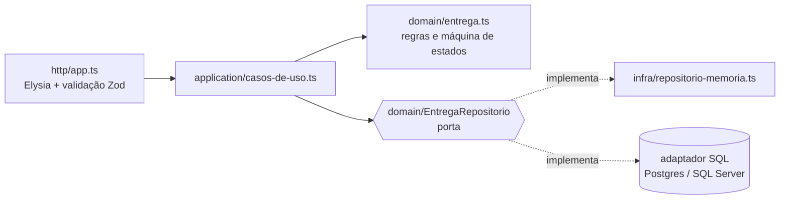

# api-entregas-typescript

API REST de **entregas logísticas** em **TypeScript** com **Bun + Elysia**, organizada em camadas (DDD com portas e adaptadores), **Zod** como contrato único e testes automatizados.

> Case de portfólio escrito do zero, com dados fictícios. Mostra os padrões que uso em APIs internas, sem nenhum código de empresa.


## O que tem aqui

- **Domínio isolado** — a entrega é uma máquina de estados (`CRIADA → COLETADA → EM_TRANSITO → EM_ENTREGA → ENTREGUE`, com `DEVOLVIDA` e retorno de tentativa frustrada). Transições inválidas e eventos fora de ordem viram erro de regra de negócio (HTTP 422).
- **Portas e adaptadores** — o domínio define `EntregaRepositorio`; o adaptador em memória atende testes e demo, e um adaptador SQL entraria sem tocar no domínio.
- **Contrato único em Zod** — os mesmos schemas validam a requisição no Elysia e geram os tipos TypeScript usados nos casos de uso.
- **Paginação keyset** — `GET /entregas?limite=20&aposId=...` em vez de `OFFSET`, que fica lento nas últimas páginas (ver [sql-performance-cases](https://github.com/GabBelo/sql-performance-cases)).
- **OpenAPI** gerada automaticamente em `/openapi`.
- **Testes** de domínio e de API (via `app.handle(Request)`, sem subir servidor) + typecheck no CI.



## Rodando

```bash
bun install
bun run dev          # http://localhost:3000  ·  docs em /openapi
bun test             # testes de domínio e API
bun run typecheck
```

Com Docker:

```bash
docker build -t api-entregas .
docker run -p 3000:3000 api-entregas
```

## Exemplos

```bash
curl -X POST localhost:3000/entregas -H "content-type: application/json" \
  -d '{"notaFiscal":"1001","ufDestino":"SC","pesoKg":250}'

curl -X POST localhost:3000/entregas/1/eventos -H "content-type: application/json" \
  -d '{"status":"COLETADA"}'

curl "localhost:3000/entregas?limite=20&status=COLETADA"
```

| Rota | Descrição |
|---|---|
| `GET /saude` | Health check |
| `POST /entregas` | Cria entrega (NF única) |
| `GET /entregas` | Lista com paginação keyset e filtro por status |
| `GET /entregas/:id` | Detalhe, eventos e lead time |
| `POST /entregas/:id/eventos` | Registra evento de rastreio |

## Estrutura

```
src/
├── domain/        # entidade, regras e porta do repositório
├── application/   # casos de uso
├── contracts/     # schemas Zod (entrada da API + tipos)
├── infra/         # adaptadores (repositório em memória)
├── http/          # app Elysia, rotas e mapeamento de erros
└── index.ts       # composição e start do servidor
tests/             # bun test
```
